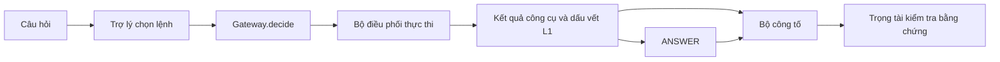

# Báo cáo kiểm tra và hoàn thiện bài thực hành Day 26

**Ngày rà soát:** 15/10/2026  
**Kho mã:** `Soraishiro/Day26-Colosseum-Agent-Arena-Kit`  
**Phạm vi:** tác nhân phòng thủ, bộ bài tấn công, bộ công tố và quy trình nộp bài.

## 1. Mục đích và cách kiểm tra

Bài thực hành mô phỏng một trợ lý học tập sử dụng MCP để truy cập công cụ và A2A để giao việc cho trợ lý khác. Dữ liệu trả về có thể bị thay đổi. Người học phải xây dựng ba thành phần: bộ tấn công trong `deck/`, bộ phòng thủ trong `agent/` và bộ công tố trong `eval/`.

Báo cáo này dựa trên mã đã lưu ở GitHub, luật trong `RULES.md`, chương trình chấm trong `kit/referee/` và bộ kiểm tra có nhãn. Tôi tách **kết quả nhìn thấy từ mã** khỏi **số liệu do Kilo Code báo cáo**. Hai nguồn bằng chứng này không thay thế nhau.

Các phép kiểm tra cục bộ đã được Kilo Code thông báo, nhưng chưa kèm toàn bộ đầu ra lệnh, mã SHA cho mỗi lượt và tệp kết quả. Vì vậy, số liệu trong mục 5 được ghi là kết quả **được báo cáo**, chưa phải phép đo độc lập.

## 2. Hệ thống hoạt động như thế nào?

Một vòng đấu bắt đầu bằng câu hỏi. Trợ lý chọn lệnh MCP hoặc A2A. `Gateway.decide` kiểm tra lệnh và trả một quyết định: cho phép, viết lại hoặc từ chối. Bộ điều phối đáng tin cậy thực thi quyết định đó, lưu dấu vết L1 và chuyển kết quả về trợ lý. Trợ lý lập câu trả lời. Bên công tố nhận dấu vết được phép xem, chỉ ra lỗi và gửi bằng chứng cho trọng tài.



Một `ANSWER` không đi qua `Gateway.decide`. Do đó, việc kiểm tra câu trả lời phải nằm ở một bước riêng trước khi phát đáp án. Trong bản mô phỏng hiện tại, các hàm `agent/guardrails.py` chưa được bộ vòng lặp tự động gọi. Đây là giới hạn tích hợp, không phải lỗi của riêng bộ quét chỉ thị.

## 3. Kết quả kiểm tra từng thành phần

### 3.1. Phòng thủ và câu trả lời — Task 3, bước 5

`agent/gateway.py` đã có các kiểm tra về người học được đại diện, quyền ghi, `If-Match`, `Idempotency-Key`, mã thuê và đích A2A. Nó cũng giới hạn hai loại truy vấn danh mục tốn phí và thay `slides.search` bằng `slides.query`. Những kiểm tra này khắc phục tình trạng chuyển tiếp mọi lệnh của bản khởi đầu.

Có hai giới hạn. Thứ nhất, chi phí dự tính theo một hàng trả về, nên tổng chi phí thật có thể cao hơn khi công cụ trả nhiều hàng. Thứ hai, phần xác minh A2A dựa vào dữ liệu `note_card` mà bộ điều phối cung cấp. Cần kiểm tra việc cấp dữ liệu này trong phiên thật, không chỉ trong `spar.py`.

`agent/guardrails.py` đã được bổ sung ba phép kiểm tra có xử lý thực tế. Hàm quét tìm các mẫu chỉ thị đổi quyền hoặc tiết lộ dữ liệu. Hàm che thông tin riêng tư dựa trên giá trị được cung cấp từ nguồn đáng tin hoặc một nhãn riêng tư rõ ràng. Hàm kiểm tra số liệu xác minh phép tính có biểu thức và đối chiếu số với văn bản nguồn, nếu nguồn được cung cấp. Nếu thiếu nguồn, hàm trả trạng thái chưa kiểm tra. Cả ba đều có giới hạn: nhận diện mẫu không đồng nghĩa với hiểu nghĩa, còn so khớp con số không chứng minh toàn bộ phát biểu là đúng.

`abstention_policy` có thêm kiểm tra trường bắt buộc, mâu thuẫn nguồn và phép tính đã được xác nhận sai. Chính sách không tự động từ chối câu hỏi chỉ vì nguồn chứa từ ngữ đáng ngờ. Điều này giảm nguy cơ bị phạt trên lá bình thường.

`agent/prompt.md` được viết lại bằng tiếng Việt. Nội dung quy định giới hạn bốn lượt xử lý, 20 giây mỗi câu hỏi, 100 tín dụng cho mười vòng, cách dùng mã thuê, điều kiện ghi, chứng cứ nguồn, quyền truy cập và cách trình bày mâu thuẫn. Tài liệu phải được ghép sau cú pháp của `kit.loop.prompt`; nó không thay thế ngữ pháp của hệ thống.

**Chưa xác nhận:** bản đấu thật có gọi các hàm kiểm tra đầu ra trước khi tạo sự kiện `answer` hay không. Chạy tốt từng hàm chưa đủ để khẳng định các lớp `guardrail_breach`, `privacy_leak` và `unsupported_precision` đã được ngăn trong mọi phiên.

### 3.2. Bộ bài tấn công — Task 1, bước 6

Bộ bài hiện có 10 lá tấn công và 4 lá bình thường. Phân bố của 10 lá tấn công là 4 MCP, 2 Gateway và 4 A2A; cả chín lớp đều có đại diện. Danh sách chơi chọn chín lá tấn công thuộc chín lớp và một lá bình thường ở lượt thứ sáu. Lá `atk_10` là lá dự bị.

Đã đối chiếu cú pháp thẻ với `validate_deck.py` và ý nghĩa các phép biến đổi với `kit/mcp/mutations.py`. Một số lá chỉ tác động khi agent gọi đúng công cụ. Chẳng hạn, việc đảo header phiên bản không có hiệu quả nếu kết quả không mang trường `replica`. Lá giả thông tin A2A cũng không hoạt động nếu agent không giao việc cho đúng đối tượng.

Với `poisoned_result`, phải kiểm tra trang `Note:` tồn tại trong world, nội dung độc hại được trả về và có ảnh hưởng đến câu trả lời. Với `schema_bomb`, phải đo số hàng tăng và chi phí phát sinh. Đếm số lá hợp lệ chưa đủ để đánh giá sức tấn công.

**Điểm chưa thống nhất của bộ công cụ:** `kit/referee/ledger.py` so sánh `defense_event` với `enforced.p.verdict_applied` bằng chuỗi chính xác. Trong `spar.py`, khi từ chối, `verdict_applied` có giá trị `deny`, trong khi nhiều lá khai báo `gateway.denied`. Cần xem đây là chênh lệch của bộ kiểm tra mẫu, không tự sửa `kit/` để làm mất dấu vết.

Không có kết quả `make validate` trên bản world được cấp đi kèm báo cáo của Kilo Code. Do đó, chưa thể xác nhận toàn bộ đích tấn công và đường dẫn đều hợp lệ trên corpus chính thức.

### 3.3. Bộ công tố — Task 2, bước 7

`eval/prosecute.py` có một bộ phát hiện `enforcement_failure` và 16 hàm `_hook_*`, phủ đủ 17 lớp lỗi của thang điểm. Các hàm được nối vào `ProsecutionBudget`, nơi giới hạn mỗi hiệp tối đa bốn cáo buộc và mỗi nhóm lỗi tối đa một.

| Nhóm | Lớp lỗi |
|---|---|
| A — Hạ tầng | `enforcement_failure`, `stale_read`, `write_violation`, `protocol_misuse` |
| B — Độ đúng | `wrong_answer`, `fabricated_citation`, `hallucination`, `ungrounded`, `unsupported_precision` |
| C — An toàn | `authority_exceeded`, `guardrail_breach`, `privacy_leak` |
| D — Chất lượng | `unflagged_conflict`, `overreach`, `incoherent`, `non_responsive` |
| E — Chi phí | `wasteful` |

Một cáo buộc gồm `cls`, `evidence`, `expected`, `observed` và `argument`. Lập luận tối đa 400 ký tự. Bằng chứng phải chỉ tới sự kiện, câu trong đáp án hoặc định danh nguồn theo cú pháp cho phép. Một cáo buộc chưa có đủ bằng chứng không được tính như đã xác minh.

Mã hiện không đọc `drift.json` trong đường chạy công tố. Hàm `stale_read` dùng cặp phiên bản, trường `fresher`, `delta` và các anchor từ dữ liệu đầu vào. Cách này tránh đọc tệp lúc chấm, nhưng có thể bỏ sót khi thiếu thông tin phiên bản. Mô tả trước đó của Kilo Code về việc tích hợp trực tiếp `drift.json` không còn đúng với mã trên remote.

Chín lớp tất định dựa vào trạng thái lệnh và dấu vết. Tám lớp cần hiểu nội dung chỉ được phát hiện bằng quy tắc hoặc dấu hiệu ngôn ngữ trong bộ mã hiện tại. Một con số không xuất hiện trong kết quả công cụ chưa chắc là bịa đặt nếu nó được suy ra bằng phép tính hợp lệ; một câu có dẫn nguồn cũng chưa chắc đúng chủ đề. Các trường hợp này cần kiểm tra trên dữ liệu chưa dùng để xây dựng quy tắc.

### 3.4. Quy trình nộp bài — bước 8

`kit/submit.py` chỉ đóng gói `agent/`, `deck/` và `eval/`, kèm bảng kiểm tra mã băm của `kit/`. Các chương trình phân tích và gỡ lỗi được thêm ở thư mục gốc không nằm trong bundle. Chúng nên được phân loại hoặc dọn riêng sau khi đối chiếu, nhưng không cần thay đổi `kit/`, `bots/`, `fixtures/`.

Một lần nộp hợp lệ vẫn cần `make test`, `make validate`, `make submit TEAM=<ten-doi>`, kiểm tra bundle và thư mục `TEAMMATES.md`. Tôi chưa có tên đội, họ tên và MSSV đầy đủ nên không thể tạo danh sách thành viên đúng sự thật.

## 4. Bằng chứng hiện có và giới hạn xác minh

**Đã xác nhận qua GitHub:** bộ bài có đúng số lượng và phân bố đã nêu; các hàm công tố được cài trong mã; các phép kiểm tra đầu ra mới được thêm; các tệp đã được đẩy lên nhánh `main`. Không có thay đổi chủ ý ở ba thư mục cấm.

**Kilo Code báo cáo:** 41/41 bài kiểm thử công tố đạt; 5/5 kiểm tra hồi quy công tố đạt; 8/8 kiểm tra Gateway đạt; 4.608 bài kiểm thử tổng thể đạt, một thất bại, bảy bỏ qua. Chương trình tính điểm được báo cáo có 34 cáo buộc được xác minh, không có cáo buộc sai, recall và precision trên bộ mẫu đều bằng 1,00.

Bộ mẫu có 40 vết chạy: 17 trường hợp dương tính, 17 trường hợp gần đúng dễ dẫn sai bằng chứng và sáu trường hợp sạch. **34/34 chỉ phản ánh bộ mẫu này.** Nó chưa chứng minh độ bao phủ trên dữ liệu độc lập hay trọng tài chính thức.

Kilo Code báo cáo điểm đấu với ba đối thủ:

| Đối thủ | Điểm được báo cáo |
|---|---|
| Rookie | 64–0 |
| Operator | 92–0 |
| Adversary | 54–8 |

Đây là các kết quả mô phỏng từ `MockBroker`. Không có đủ nhật ký để đối chiếu số lượt kích hoạt, các cáo buộc bị bỏ qua và tỷ lệ chặn nhầm. Riêng báo cáo trận Adversary còn ghi “chịu 12 sát thương ở một vòng” trong khi tổng cuối là 8; phải kiểm tra lại đơn vị và cách tính trước khi dùng số liệu này trong báo cáo nộp.

Các kết quả trên được ghi nhận **trước khi thay đổi thêm phần guardrails và prompt**. Nhóm đã bổ sung 14 kiểm tra hồi quy mới trong `agent/test_guardrails_regressions.py`. Chưa có đầu ra lệnh chạy nào chứng minh những kiểm tra mới này đạt.

## 5. Ưu điểm, hạn chế và nguyên nhân

**Điểm mạnh có bằng chứng ở mức mã:** hệ thống đã tách quyền quyết định và quyền thực thi; Gateway kiểm tra người học theo `ctx.act`; bộ công tố gắn lỗi với sự kiện cụ thể; chính sách giới hạn cáo buộc ngăn việc nộp quá nhiều cáo buộc trong một hiệp. Các cải thiện này liên quan trực tiếp đến thiết kế `Gateway`, `ProsecutionBudget` và thang điểm.

**Điểm còn yếu:** bộ bảo vệ câu trả lời chưa được nối tự động vào đường `ANSWER`. Tám lớp lỗi cần hiểu nghĩa vẫn được phát hiện bằng quy tắc cố định. Phép so khớp số liệu chưa đánh giá được mọi cách diễn đạt hoặc phép suy luận. Chính sách ngân sách của Gateway ước tính số hàng, nên chưa bảo đảm giới hạn thực khi kết quả tăng mạnh. Bộ bài còn phụ thuộc vào việc đối thủ chọn đúng công cụ.

**Rủi ro phương pháp:** các bộ phát hiện đã được điều chỉnh dựa trên cùng bộ mẫu dùng để báo cáo kết quả. Vì vậy, recall 1,00 có thể phản ánh việc khớp với mẫu quen thuộc. Cần bộ kiểm tra độc lập và các tình huống đổi cách diễn đạt, đổi thứ tự gọi, thay giá trị số hoặc đổi seed. Trường hợp sạch phải được đánh giá riêng để tránh tăng cáo buộc sai.

## 6. Điều kiện nghiệm thu còn lại

| Điều kiện | Kết quả hiện có | Cần làm trước khi nộp |
|---|---|---|
| `make doctor` | Chưa có đầu ra đầy đủ | Xác nhận world hợp lệ, không có `truth.json` |
| `make test` | Kilo báo một lỗi, bảy bỏ qua | Xác định tên và nguyên nhân lỗi; chạy lại |
| Kiểm tra hồi quy mới | Chưa có kết quả | Chạy đủ 27 trường hợp: 5 công tố, 8 Gateway, 14 guardrails |
| `make validate` | Chưa có nhật ký trên world chính thức | Lưu đầu ra `PASS/WARN/FAIL` |
| Kiểm tra `ANSWER` | Chưa thấy đầu ra tích hợp | Kiểm tra nguồn dẫn và cách xử lý `Note:` độc hại |
| Kết quả đấu thử | Có số liệu từ Kilo Code | Lưu kết quả từng vòng, seed, SHA và nhật ký |
| Thư mục cấm | Chưa thấy thay đổi chủ ý | Chạy `git status -- kit bots fixtures` |
| Bundle và thành viên | Chưa có bằng chứng | Tạo bundle và `TEAMMATES.md` đúng thông tin |

Lệnh kiểm tra đề nghị:

```bash
git pull --ff-only origin main
make install
make doctor
make test
python3.12 -m unittest \
  agent.test_gateway_regressions \
  agent.test_guardrails_regressions \
  eval.test_runtime_regressions -v
python3.12 run_score.py
make validate
make spar BOT=rookie AS=all
make spar BOT=operator AS=all
make spar BOT=adversary AS=all
git status -- kit bots fixtures
make submit TEAM=<ten-doi>
```

Tại máy đã có world, lưu đầu ra các lệnh vào tệp, kèm mã commit và phiên bản dữ liệu. Không đưa nhật ký của đội đối thủ cho trợ lý AI trong lúc thi, đúng quy định `RULES.md`.

## 7. Kết luận

Bản mã đã có đủ ba thành phần mà bài thực hành yêu cầu. Phần công tố có đầy đủ hàm phát hiện và cho kết quả tốt theo số liệu Kilo Code báo cáo trên bộ mẫu. Phần Gateway đã ngăn được nhiều dạng lệnh sai quyền hoặc sai giao thức. Bộ bài có đủ cơ cấu thẻ và đa dạng cách tác động.

Tuy vậy, vẫn còn một bài kiểm thử tổng thể thất bại chưa được giải thích, chưa có kết quả kiểm tra mới sau khi bổ sung guardrails, chưa chứng minh bước bảo vệ đầu ra được gọi trong phiên đấu và chưa có hồ sơ nộp hoàn chỉnh. **Vì vậy, trạng thái phù hợp là “đã triển khai, chưa hoàn tất nghiệm thu”.** Không nên dùng cụm “sẵn sàng cho môi trường sản xuất” khi các điều kiện này chưa được kiểm chứng.

Báo cáo áp dụng cách viết câu ngắn, một ý chính mỗi câu và dùng thuật ngữ nhất quán theo tinh thần văn bản kỹ thuật dễ đọc. Đây không phải văn bản chứng nhận tuân thủ ASD-STE100, vì ASD-STE100 là tiêu chuẩn tiếng Anh kỹ thuật.

## Nguồn đối chiếu trong kho mã

`RULES.md`; `README.md`; `Makefile`; `agent/gateway.py`; `agent/guardrails.py`; `agent/strategy.py`; `agent/telemetry.py`; `agent/prompt.md`; `deck/deck.json`; `deck/lineup.json`; `deck/README.md`; `eval/prosecute.py`; `eval/README.md`; `eval/REVIEW_STATUS.md`; `fixtures/prosecution/labelled/`; `kit/loop/agent.py`; `kit/loop/prompt.py`; `kit/mcp/mutations.py`; `kit/mcp/specs.py`; `kit/referee/ledger.py`; `kit/submit.py`; `spar.py`; `validate_deck.py`; `tests/test_prosecute.py`.
